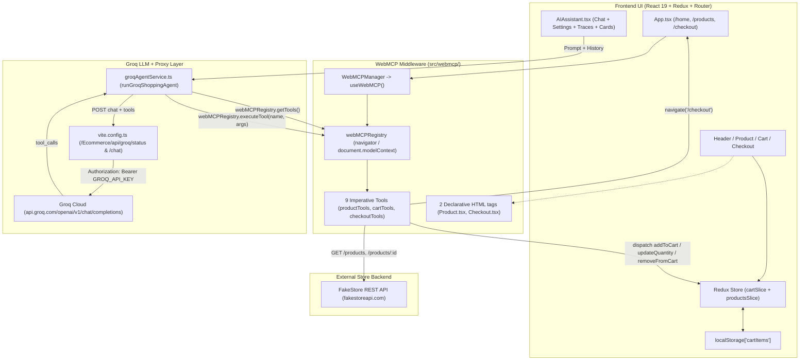

# E-Commerce Storefront with WebMCP & Groq LLM — Technical Documentation

> **Single source of truth** describing the current architecture, frontend, backend APIs, WebMCP middleware, Groq LLM integration, Vite proxy, end-to-end flows, security guardrails, and verification steps.

---

## 1. Overview & Tech Stack

**Our Styles** is a React + TypeScript e-commerce storefront equipped with an in-app **AI Shopping Assistant** powered by **Groq LLM** and standardized **WebMCP (Web Model Context Protocol)** tools.

| Layer | Technology | Version / Source |
|---|---|---|
| **UI Framework** | React + TypeScript | `react` `^19.1.0`, `typescript` `~5.8.3` |
| **Build & Dev Server** | Vite + Tailwind CSS | `vite` `^6.3.5`, `@tailwindcss/vite` `^4.1.10` |
| **State Management** | Redux Toolkit + React Redux | `@reduxjs/toolkit` `^2.8.2`, `react-redux` `^9.2.0` |
| **Routing** | React Router DOM (`HashRouter`) | `react-router-dom` `^7.6.2` |
| **Notifications & Icons** | React Toastify, React Icons, FontAwesome | `react-toastify` `^11.0.5`, `react-icons` `^5.5.0` |
| **LLM Inference** | Groq Chat Completions API (OpenAI-compatible tool calling) | `openai/gpt-oss-20b` (default), `openai/gpt-oss-120b` |
| **Product Catalog Backend** | FakeStore REST API | `https://fakestoreapi.com` |
| **Tool Protocol** | WebMCP (`navigator.modelContext` / `document.modelContext`) | `src/webmcp/` (9 imperative tools + 2 HTML tags) |

---

## 2. Repository Structure

```text
Ecommerce/
├── .env                                    # Non-secret defaults (GROQ_MODEL, VITE_GROQ_API_URL)
├── .gitignore                              # Ignores *.local (put secret GROQ_API_KEY in .env.local)
├── DOCUMENTATION.md                        # This documentation
├── package.json                            # Scripts & dependencies
├── vite.config.ts                          # Vite config (base: /Ecommerce/) + groqProxyPlugin
└── src/
    ├── main.tsx                            # React root + Redux Provider
    ├── App.tsx                             # Router, WebMCPManager, Layout, AIAssistant, ToastContainer
    ├── store.ts                            # Redux store (cart + products reducers)
    ├── hooks.ts                            # Typed Redux hooks (useAppDispatch, useAppSelector)
    ├── components/
    │   ├── Header/Header.tsx               # Navigation & live cart item count badge
    │   ├── Home/Home.tsx                   # Landing page
    │   ├── Product/Product.tsx             # Catalog page with search/category/price/rating filters
    │   ├── Cart/Cart.tsx                   # Slide-over shopping cart drawer
    │   ├── Checkout/Checkout.tsx           # Shipping & payment form + order confirmation
    │   ├── Footer/Footer.tsx               # Page footer
    │   └── AIAssistant/AIAssistant.tsx     # Floating Groq LLM + WebMCP chat assistant & settings UI
    ├── features/
    │   ├── cart/
    │   │   ├── cartSlice.tsx               # Cart reducers + localStorage['cartItems'] sync
    │   │   └── types.ts                    # CartItem types
    │   └── products/
    │       ├── productsSlice.ts            # fetchProducts async thunk + catalog state
    │       └── types.ts                    # Product interface
    ├── services/
    │   ├── productService.ts               # FakeStore REST API client
    │   └── groqAgentService.ts             # Groq LLM client + multi-round WebMCP tool loop
    └── webmcp/
        ├── types.ts                        # WebMCPTool, JSONSchema, ModelContext types
        ├── registry.ts                     # WebMCPRegistry + initializeWebMCP()
        ├── useWebMCP.ts                    # React hook registering all 9 tools with AbortSignal
        ├── WebMCPManager.tsx               # Headless component mounted in App.tsx
        └── tools/
            ├── productTools.ts             # search_products, get_product_details, filter_products
            ├── cartTools.ts                # get_cart, add_to_cart, update_cart, remove_from_cart
            └── checkoutTools.ts            # apply_coupon, start_checkout
```

---

## 3. End-to-End System Architecture



---

## 4. Layer Details

### 4.1 Frontend (React, Redux Toolkit, React Router)
- **Entry & Routing:** `src/main.tsx` mounts `<App />` inside `<Provider store={store}>`. `src/App.tsx` sets up `HashRouter` with routes `/` (redirects to `/home`), `/home`, `/products`, `/checkout`, and fallback `*`.
- **State Store (`src/store.ts`):**
  - `products`: populated on `/products` via `fetchProducts()` thunk in `src/features/products/productsSlice.ts`.
  - `cart`: hydrated from `localStorage.getItem('cartItems')` in `src/features/cart/cartSlice.tsx`. Every reducer (`addToCart`, `updateQuantity`, `removeFromCart`, `incrementQuantity`, `decrementQuantity`, `clearCart`) writes updated items back to `localStorage['cartItems']`.
- **Reactive Sync:** `Header.tsx` and `Cart.tsx` read `state.cart.items` via `useAppSelector`, so UI badges, subtotals, and drawer contents update instantaneously whether triggered by buttons or by WebMCP tools.

### 4.2 Backend & External APIs
- **Catalog API (`src/services/productService.ts`):**
  - `productService.getProducts()` → `GET https://fakestoreapi.com/products`
  - `productService.getProductById(id)` → `GET https://fakestoreapi.com/products/${id}`
- **Cart & Order Handling:**
  - Cart persistence runs client-side in Redux + `localStorage['cartItems']`.
  - FakeStore API has no coupon/discount or payment endpoint; `apply_coupon` reports `status: 'UNAVAILABLE'`, and `Checkout.tsx` validates customer inputs (`name`, `email`, `address`, `paymentOption`), simulates a 1.5s order confirmation, and clears the cart with `clearCart()`.

### 4.3 WebMCP Middleware (`src/webmcp/`)
- **Initialization:** `WebMCPManager` invokes `useWebMCP()`, which calls `initializeWebMCP()` in `src/webmcp/registry.ts` to bind `webMCPRegistry` to `document.modelContext`, `navigator.modelContext`, and `window.modelContext` (preserving native browser implementations if already present, and delegating `registerTool` calls to native `navigator.modelContext` / `document.modelContext` when supported).
- **Lifecycle Management:** All 9 tools are registered with an `AbortController` `signal` inside `useEffect`, ensuring clean unregistration on unmount.
- **Declarative HTML Tags (for browser-native agents):**
  - `src/components/Product/Product.tsx`: search `<input>` carries `tool-name="search_products_input"` and `tool-description`.
  - `src/components/Checkout/Checkout.tsx`: `<form>` carries `tool-name="submit_checkout_form"` and `tool-description`, while `name`, `email`, `address`, and `paymentOption` inputs carry `tool-prop-description`.

#### Registered Imperative WebMCP Tools (9 Tools)

| Tool Name | Source File | Behavioral Hint | Parameters (`inputSchema`) | Action Performed |
|---|---|---|---|---|
| `search_products` | `productTools.ts` | `readOnlyHint: true` | `query` *(req)*, `category`, `minPrice`, `maxPrice`, `limit` | Fetches `productService.getProducts()`, matches all query words against `title` + optional filters |
| `get_product_details` | `productTools.ts` | `readOnlyHint: true` | `productId` *(req)* | Fetches `productService.getProductById(productId)` including `description` |
| `filter_products` | `productTools.ts` | `readOnlyHint: true` | `query`, `category`, `minPrice`, `maxPrice`, `minRating`, `limit` | Fetches `productService.getProducts()`, filters across category, price range, rating, and optional keyword |
| `get_cart` | `cartTools.ts` | `readOnlyHint: true` | *(none)* | Reads `store.getState().cart.items`; computes `itemCount`, `uniqueItemCount`, `totalAmount`, item subtotals |
| `add_to_cart` | `cartTools.ts` | `consequentialHint: true` | `productId` *(req)*, `quantity` *(def 1)*, `confirmed` *(def false)* | Looks up authentic price via `getProductById`; requires `confirmed: true`, else returns `requiresConfirmation: true`; dispatches `addToCart` + `toast.success` |
| `update_cart` | `cartTools.ts` | `consequentialHint: true` | `productId` *(req)*, `quantity` *(req)* | Validates item is in cart; dispatches `removeFromCart` if `quantity === 0`, else `updateQuantity` + `toast.info` |
| `remove_from_cart` | `cartTools.ts` | `consequentialHint: true` | `productId` *(req)* | Validates item is in cart; dispatches `removeFromCart` + `toast.info` |
| `apply_coupon` | `checkoutTools.ts` | *(none)* | `code` *(req)* | Returns `{ applied: false, status: 'UNAVAILABLE', availableDiscount: 0 }` (honest API capability status) |
| `start_checkout` | `checkoutTools.ts` | `consequentialHint: true` | `confirmed` *(def false)* | Checks cart non-empty (`CART_EMPTY`); requires `confirmed: true`, else returns `requiresConfirmation: true`; executes `navigate('/checkout')` |

### 4.4 Groq LLM Integration & Vite Proxy

#### `src/services/groqAgentService.ts`
- **Dynamic Tool Binding:** `toOpenAITools()` converts live tools from `await webMCPRegistry.getTools()` into OpenAI/Groq `function` schemas (preserving parameter schemas and appending `[read-only]` / `[mutates state]` hints).
- **Model & Inference Parameters:**
  - Default model: `openai/gpt-oss-20b` (`DEFAULT_GROQ_MODEL`) with `reasoning_effort: 'low'` for `openai/gpt-oss-*` models.
  - Selectable preset: `openai/gpt-oss-120b` (or any custom model ID).
  - Settings: `temperature: 0.2`, `max_completion_tokens: 2048`, `tool_choice: 'auto'`.
- **Multi-Round Tool Loop (`runGroqShoppingAgent`):**
  - Prepends `SYSTEM_PROMPT` (grounding rules, INR `Rs.` currency, FakeStore's 4 categories, singular keyword guidance, `filter_products` fallback when `search_products` returns 0 matches, confirmation safety, honest coupon handling).
  - Maintains up to `MAX_HISTORY_MESSAGES = 24` messages, trimming only on `user` message boundaries (`trimHistory`).
  - Loops up to `MAX_TOOL_ROUNDS = 6` when Groq returns `tool_calls`:
    1. Parses arguments safely (`parseToolArguments`); malformed JSON is returned as `{ error: true, message }` so the LLM can recover.
    2. Calls `await webMCPRegistry.executeTool(toolName, args)`.
    3. Captures every execution in `ToolCallTrace[]` (`id`, `name`, `input`, `output`).
    4. Deduplicates returned products (`collectProductsFromToolResult`) into `products: Product[]` for inline product cards.
    5. Tracks `requiresConfirmation: true` for `add_to_cart` / `start_checkout` (`pendingConfirmation`) and clears it when `success: true` completes.
    6. Appends `{ role: 'tool', tool_call_id, name, content: JSON.stringify(toolOutput) }` and calls Groq for the next round.

#### Endpoint Routing (`requestGroqCompletion`)
Requests route in this priority order:
1. **Custom Backend URL (`VITE_GROQ_API_URL`):** POSTs to `VITE_GROQ_API_URL` (for deployed production proxy backends).
2. **Client-Provided Key (BYOK in ⚙️ Settings):** When `apiKey` is saved in `localStorage['ecommerce_groq_api_key']`, POSTs directly to `https://api.groq.com/openai/v1/chat/completions` with `Authorization: Bearer <key>`.
3. **Local Vite Proxy (Default):** POSTs to `/Ecommerce/api/groq/chat` handled by `groqProxyPlugin` in `vite.config.ts`.

#### Vite Proxy Middleware (`vite.config.ts`)
- Registered on both `configureServer` (`npm run dev`) and `configurePreviewServer` (`npm run preview`).
- Reads `GROQ_API_KEY` and `GROQ_MODEL` on the Node server via Vite's `loadEnv(mode, process.cwd(), '')` (never bundled into `dist/`).
- Exposes:
  - `GET /api/groq/status` & `/Ecommerce/api/groq/status` → returns `{ configured: boolean, defaultModel: string }`.
  - `POST /api/groq/chat` & `/Ecommerce/api/groq/chat` → injects `Authorization: Bearer <GROQ_API_KEY>`, fills default `model` if omitted, forwards to `https://api.groq.com/openai/v1/chat/completions`, and returns `503` JSON if `GROQ_API_KEY` is missing.

### 4.5 AI Assistant UI (`src/components/AIAssistant/AIAssistant.tsx`)
- **Live Readiness Badge:** Checks `serverStatus.configured || Boolean(apiKey) || hasCustomEndpoint` on mount via `checkGroqServerStatus()` and displays `● Groq (<model>)` (green) or `● Setup Groq API Key` (amber).
- **⚙️ Settings Drawer:** Lets users switch models (`openai/gpt-oss-20b`, `openai/gpt-oss-120b`, or custom ID) and optionally enter/clear a client-side Groq API key (`localStorage`).
- **Reset Chat (`FaRedo`):** Clears `llmHistoryRef` and UI message history.
- **Expandable Tool Traces:** Clicking any `⚡ WebMCP: <tool_name>` badge toggles raw JSON `input` and `output`.
- **Confirmation Quick Actions & Card Quick Add:** Renders **Confirm / Cancel** buttons when `pendingConfirmation` is active, and **Add** buttons on up to 4 inline product cards (`handleQuickAdd`).

---

## 5. Question-to-API Execution Reference

| Trigger / User Input | LLM Request | WebMCP Tool(s) Called | Backend / Redux Action | UI Result |
|---|---|---|---|---|
| **App opens on `/products`** | *(none)* | *(none)* | `GET https://fakestoreapi.com/products` (`fetchProducts`) | Renders product grid |
| **Chat widget mounts** | `GET /Ecommerce/api/groq/status` | *(none)* | Vite proxy checks server `GROQ_API_KEY` | Header displays live Groq status |
| *"Show me Fit T-Shirts under 30"* | `POST /Ecommerce/api/groq/chat` | `search_products({ query: "Fit T-Shirts", maxPrice: 30 })` | `GET https://fakestoreapi.com/products` | Reply + `⚡ WebMCP` trace + inline product card (`Rs.22.3`) |
| *"Show me rings"* *(0 title matches)* | `POST /Ecommerce/api/groq/chat` | `search_products` → `filter_products({ category: "jewelery" })` | `GET https://fakestoreapi.com/products` | Lists matching jewelry items |
| *"Tell me more about product 2"* | `POST /Ecommerce/api/groq/chat` | `get_product_details({ productId: 2 })` | `GET https://fakestoreapi.com/products/2` | Full description, price, rating + card |
| *"Add product 2 to my cart"* | `POST /Ecommerce/api/groq/chat` | `add_to_cart({ productId: 2, quantity: 1, confirmed: false })` | `GET https://fakestoreapi.com/products/2` → returns `requiresConfirmation: true` | Asks confirmation + renders **Confirm / Cancel** buttons |
| **Clicks "Confirm" / types "Yes"** | `POST /Ecommerce/api/groq/chat` | `add_to_cart({ productId: 2, quantity: 1, confirmed: true })` | `GET /products/2` → `dispatch(addToCart)` → `localStorage['cartItems']` | Header badge updates, toast fires, cart synced |
| **Clicks "Add" on product card** | `POST /Ecommerce/api/groq/chat` | `add_to_cart({ productId, quantity: 1, confirmed: true })` | `GET /products/:id` → `dispatch(addToCart)` → `localStorage['cartItems']` | Item added immediately + LLM history synced |
| *"What is in my cart?"* | `POST /Ecommerce/api/groq/chat` | `get_cart({})` | Reads Redux `store.getState().cart.items` | Reports exact items, quantities, and total |
| *"Update product 2 qty to 3"* | `POST /Ecommerce/api/groq/chat` | `update_cart({ productId: 2, quantity: 3 })` | `dispatch(updateQuantity)` → `localStorage['cartItems']` | Updates cart & toast |
| *"Remove product 2"* | `POST /Ecommerce/api/groq/chat` | `remove_from_cart({ productId: 2 })` | `dispatch(removeFromCart)` → `localStorage['cartItems']` | Removes item & toast |
| *"Apply coupon SAVE20"* | `POST /Ecommerce/api/groq/chat` | `apply_coupon({ code: "SAVE20" })` | Returns `{ applied: false, status: "UNAVAILABLE" }` | Explains coupons are unsupported |
| *"Proceed to checkout"* | `POST /Ecommerce/api/groq/chat` | `start_checkout({ confirmed: false })` → after confirm → `confirmed: true` | `navigate('/checkout')` | Opens Checkout page for manual payment |

---

## 6. Security & Safety Guarantees

1. **Server-Side API Key Isolation:** `GROQ_API_KEY` has no `VITE_` prefix and is read only inside `vite.config.ts` on Node (`loadEnv`), so the key is never bundled into `dist/` or visible in browser requests when using the proxy.
2. **Tamper-Proof Pricing:** `add_to_cart` ignores any LLM-supplied price and fetches the authoritative price via `productService.getProductById(productId)`.
3. **Human Confirmation Gates:** Both `add_to_cart` and `start_checkout` enforce `confirmed: true` at the WebMCP tool layer before modifying cart state or navigating.
4. **No Automatic Payments:** `start_checkout` only navigates to `#/checkout`; final order submission is performed manually by the user on the checkout form.
5. **Truthful Capability Reporting:** `apply_coupon` explicitly returns `status: 'UNAVAILABLE'` instead of fabricating client-side discounts.

---

## 7. Setup, Commands & Verification

### Configure Groq API Key
- **Option A — Local Dev/Preview Proxy (Recommended):**
  Create `.env.local` in the project root (ignored by git via `*.local` in `.gitignore`):
  ```env
  GROQ_API_KEY=gsk_your_api_key_here
  ```
- **Option B — Browser Settings UI:**
  Start the app, open **AI Assistant (Groq + WebMCP)**, click **⚙️**, paste your Groq key from `https://console.groq.com/keys`, and click **Save**.
- **Option C — Production Deployment Proxy:**
  Set `VITE_GROQ_API_URL=https://your-backend-proxy.example.com/api/groq/chat` at build time.

### Commands
```bash
# Install dependencies
npm install

# Run development server (with Vite Groq proxy)
npm run dev

# TypeScript check + production build
npm run build

# Preview production build locally (with Vite Groq proxy)
npm run preview
```

